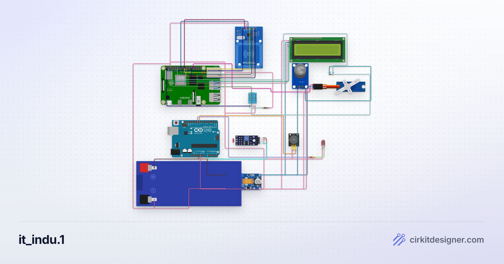

# Électronique et câblage — Next Factory

**Responsable :** NOUIRA Ismail — 4A Robotique & Instrumentation (Polytech Dijon)

Ce dossier regroupe le schéma de câblage électrique (`schema_usine_connectee.png`) et la liste des composants (`bom_composants.csv`) du prototype **Next Factory**, alignés sur le code embarqué du dépôt (`arduino/src/main.cpp` et `test.py/main.py`).

## Architecture matérielle retenue

Le montage repose sur une répartition **Maître / Esclave** entre un **Raspberry Pi 4** et un **Arduino Uno** reliés en série USB (9600 bauds) :

* **Raspberry Pi 4 (Maître)** : contrôle d'accès RFID, affichage LCD, lecture température/humidité, surveillance fumée et pilotage du servomoteur de porte.
* **Arduino Uno (Esclave)** : lecture analogique de la luminosité (LDR sur `A0`) et pilotage des actionneurs d'alerte en 5 V (buzzer et LED).

Ce découpage évite d'ajouter un convertisseur analogique-numérique externe sur le Raspberry Pi (qui n'a pas d'entrée analogique native) tout en laissant l'Arduino gérer l'éclairage automatique et l'alarme sonore sur réception d'un simple octet série (`A` pour alarme, `N` pour retour à la normale).

## Problèmes rencontrés et solutions mises en place

* **Chutes de tension liées au servomoteur et aux modules 5 V :** Alimenter le servo SG90, l'écran LCD et le capteur de fumée directement depuis la broche 5 V du Raspberry Pi provoque des chutes de tension lors des pics de courant (blocage ou démarrage du servo). L'alimentation a donc été séparée en trois zones reliées par une **masse commune (`GND`)** :
  1. **Rail puissance 5 V** (batterie 12 V + régulateur BEC 5 V) pour le SG90, le LCD 16x2 et le capteur de fumée K869051.
  2. **Rail logique 3,3 V** (issu du Pi) pour le lecteur RFID-RC522 et le DHT11.
  3. **Rail 5 V Arduino** (via USB) pour le module LDR, la LED et le buzzer.
* **Protection des GPIO 3,3 V face au capteur de fumée :** La sortie numérique `DO` du K869051 travaille en 5 V, ce qui risque d'endommager l'entrée du Raspberry Pi. Un **pont diviseur de tension** (`R1 = 1 kΩ` en série, `R2 = 2 kΩ` vers la masse) abaisse le signal à **3,33 V** avant d'arriver sur `GPIO 27`.
* **Conflit SPI sur le lecteur RFID sous Ubuntu :** Le noyau Linux réserve `GPIO 8 (CE0)` dès que le bus SPI est actif, ce qui déclenche une erreur `lgpio` avec `pirc522`. La broche `SDA/CS` du RC522 a été déportée sur `GPIO 5 (PHY 29)` en forçant la numérotation `BCM` côté logiciel.

## Table de câblage (Pinout)

### Raspberry Pi 4 (numérotation BCM)

| Composant | Broche module | BCM | Broche physique | Bus / Signal | Alimentation |
| :--- | :--- | :--- | :--- | :--- | :--- |
| **RFID-RC522** | SDA (CS) | GPIO 5 | Pin 29 | SPI (CS logiciel) | 3,3 V (Pi) |
| | MISO | GPIO 9 | Pin 21 | SPI | 3,3 V (Pi) |
| | MOSI | GPIO 10 | Pin 19 | SPI | 3,3 V (Pi) |
| | SCK | GPIO 11 | Pin 23 | SPI | 3,3 V (Pi) |
| | IRQ | GPIO 24 | Pin 18 | Interruption | 3,3 V (Pi) |
| | RST | GPIO 25 | Pin 22 | Reset | 3,3 V (Pi) |
| **LCD 16x2 I2C** | SDA | GPIO 2 | Pin 3 | I2C (`0x27`) | 5 V (BEC) |
| | SCL | GPIO 3 | Pin 5 | I2C (`0x27`) | 5 V (BEC) |
| **DHT11** | DATA | GPIO 4 | Pin 7 | 1-Wire | 3,3 V (Pi) |
| **Fumée K869051** | DO | GPIO 27 | Pin 13 | Numérique (via pont 1 kΩ / 2 kΩ) | 5 V (BEC) |
| **Servo SG90** | Signal | GPIO 12 | Pin 32 | PWM matériel | 5 V (BEC) |

### Arduino Uno

| Composant | Broche module | Broche Arduino | Signal | Alimentation |
| :--- | :--- | :--- | :--- | :--- |
| **Module LDR** | AO | A0 | Analogique (`0` = clair, `1023` = sombre) | 5 V (Arduino) |
| **Buzzer** | Signal (+) | D9 | PWM (`tone`, 1500 Hz) | 5 V (Arduino) |
| **LED d'alerte** | Anode (+) | D10 | Numérique (résistance 220 Ω en série) | 5 V (Arduino) |

## Points de vigilance matériels

* **Liaison USB Pi ↔ Arduino :** Non représentée broche à broche sur le schéma Cirkit Designer ; la connexion se fait par un câble USB standard (port `/dev/ttyUSB0` ou `/dev/ttyACM0`).
* **Pull-ups I2C du module LCD :** Si l'adaptateur `PCF8574` utilisé embarque des résistances de tirage reliées à son alimentation 5 V, il est conseillé d'intercaler un translateur de niveau bidirectionnel 3,3 V / 5 V sur `SDA` et `SCL` pour un fonctionnement prolongé sans risque sur le Pi.